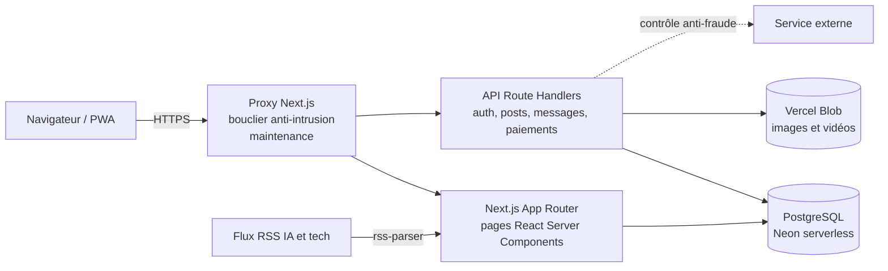

# Architecture de Teedaïk

## Vue d'ensemble



## Parcours d'une requête

1. **Proxy** : chaque requête passe d'abord par le bouclier. Une adresse bloquée reçoit une page 403 avec une référence, sans jamais atteindre l'application.
2. **Rendu** : les pages sont rendues côté serveur. La session de l'utilisateur est lue **une seule fois par rendu** (mise en cache avec `React.cache`), au lieu d'une dizaine de requêtes identiques auparavant.
3. **API** : chaque route d'écriture enchaîne les contrôles dans le même ordre, du moins coûteux au plus coûteux :

```
validation des entrées → session → limitation de débit → (contrôle anti-fraude si action sensible) → action en base
```

## Base de données

- **PostgreSQL serverless (Neon)**, accédé par HTTP depuis les fonctions Vercel.
- **Migrations « à la demande »** : chaque module crée ses tables avec `CREATE TABLE IF NOT EXISTS`. Pour éviter que des centaines d'instances serverless rejouent ces instructions, chaque instruction n'est exécutée **qu'une seule fois**.
- **Principales entités** : membres, sessions, publications, commentaires, j'aime, abonnements, conversations et messages, stories, vidéos, pages entreprises, journaux de sécurité, consentements RGPD.

## Choix techniques et compromis

| Choix | Raison |
|---|---|
| Next.js App Router | Un seul projet pour le front, l'API et le rendu serveur (SEO). |
| Neon serverless | Postgres complet, facturé à l'usage, adapté à un projet lancé sans financement. |
| Limitation de débit **en SQL** plutôt que Redis | Aucun service supplémentaire à payer ni à maintenir. Suffisant au volume actuel. |
| 2FA codée **sans bibliothèque** | Moins de dépendances, donc moins de risques côté chaîne d'approvisionnement. Le code suit la RFC 6238. |
| Déploiement **Vercel** | Pas de serveur à administrer : HTTPS, CDN et mises à l'échelle gérés automatiquement. |
