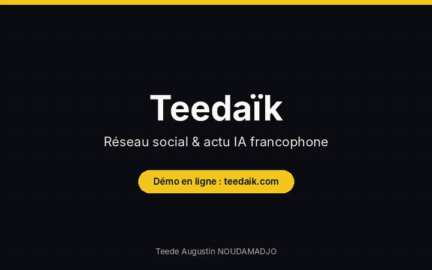
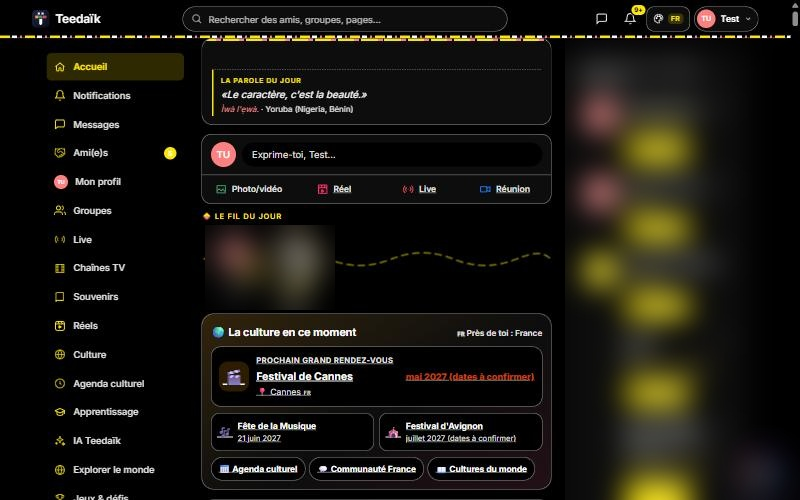
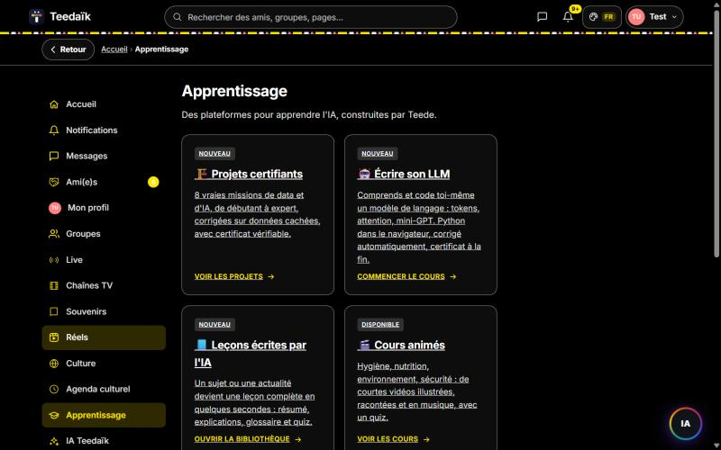
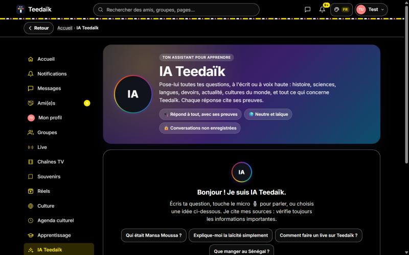

# Teedaïk — vitrine technique

> **L'actualité IA et tech, agrégée en continu et discutée par une communauté de pros.**
> Réseau social francophone, agrégateur d'actualités et plateforme d'apprentissage, en production.

🌍 **Site en ligne : [teedaik.com](https://teedaik.com)**

  
  

  

Démo animée. Cliquez sur <b>Vidéo HD</b> pour la version MP4, ou sur <b>Essayer en ligne</b> pour tester le site.

### 📸 Captures d'écran

<table>
  <tr>
    <td></td>
    <td></td>
    <td></td>
  </tr>
</table>

🔒 Les noms et photos des membres sont floutés dans les captures.

⚠️ **Ce dépôt est une vitrine.** Le code source complet de Teedaïk reste privé. Vous trouverez ici l'architecture, la démarche de sécurité et une sélection d'**extraits de code inspirés de la production**. Ils sont **simplifiés** : aucun secret, aucune donnée de membre, et aucun réglage de sécurité réel (seuils, règles de détection, noms de tables, configuration). Ils montrent la **méthode**, pas la recette exacte.

---

## 🎯 Le projet

Teedaïk transforme le fil d'actualité passif en espace d'apprentissage actif : chaque article IA ou tech peut devenir une mini-leçon. La plateforme réunit :

- un **fil d'actualités IA et tech** agrégé automatiquement depuis des flux RSS ;
- un **réseau social** : publications, commentaires, j'aime, abonnements, stories, vidéos, messagerie privée ;
- des **profils et portfolios** de projets, ainsi qu'un annuaire de pages entreprises ;
- un espace **Apprentissage**, avec des cours intégrés et des vidéos éducatives ;
- une **application installable** (PWA).

Je conçois, développe et opère le projet **seul**, de l'idée à la mise en production.

---

## 🧱 Stack technique

| Couche | Technologies |
|---|---|
| Front-end | Next.js (App Router) · React 19 · TypeScript · Tailwind CSS v4 |
| Back-end | Route Handlers Next.js (API REST) · proxy Next.js (middleware) |
| Base de données | PostgreSQL serverless (Neon) |
| Fichiers | Vercel Blob (images, vidéos) |
| Agrégation | rss-parser |
| Sécurité | Argon2id · TOTP (RFC 6238) · limitation de débit · bouclier anti-intrusion |
| Hébergement | Vercel |

➡️ Détails dans **[ARCHITECTURE.md](ARCHITECTURE.md)**

---

## 🔐 Sécurité : le cœur de cette vitrine

Une plateforme sociale manipule des comptes, des messages privés et des paiements. La sécurité a donc été pensée **en couches** :

1. **Identité** : mots de passe en Argon2id, double authentification TOTP, sessions révocables.
2. **Abus** : anti force brute, limitation de débit sur chaque action, limite d'inscriptions.
3. **Intrusion** : bouclier qui détecte scanners, injections et sondages de fichiers sensibles, puis bloque progressivement.
4. **Fraude** : contrôle renforcé sur les actions sensibles uniquement.
5. **Navigateur** : en-têtes HTTP de sécurité (HSTS, CSP, anti-clickjacking…).
6. **Vie privée** : RGPD (consentements, export, effacement).

➡️ Explications complètes dans **[SECURITY.md](SECURITY.md)**

---

## 📂 Extraits de code

| Fichier | Ce qu'il montre |
|---|---|
| [`src/lib/password.ts`](src/lib/password.ts) | Hachage Argon2id, migration bcrypt vers Argon2id, temps de réponse constant |
| [`src/lib/session.ts`](src/lib/session.ts) | Jeton aléatoire révocable, cookie `httpOnly` / `secure` / `sameSite` |
| [`src/app/api/auth/login/route.ts`](src/app/api/auth/login/route.ts) | Ordre des contrôles d'une connexion : bouclier, anti force brute, mot de passe, 2FA |
| [`src/lib/totp.ts`](src/lib/totp.ts) | Double authentification TOTP sans dépendance, comparaison à temps constant |
| [`src/lib/rate-limit.ts`](src/lib/rate-limit.ts) | Principe d'un compteur atomique en SQL, partagé entre instances serverless |
| [`src/lib/shield-inspect.ts`](src/lib/shield-inspect.ts) | Principe du bouclier anti-intrusion (exemples de signatures publiques) |
| [`next.config.ts`](next.config.ts) | En-têtes HTTP de sécurité |

> 🔒 Les réglages réels (seuils, règles, durées, schéma de base, configuration) restent dans le dépôt privé.

---

## 🧭 Démarche

- **Livrer, mesurer, corriger** : les incidents de production sont diagnostiqués, corrigés puis vérifiés en conditions réelles.
- **Documenter** : un dossier de passation complet permet à quelqu'un d'autre de reprendre le projet.

---

## 👤 Auteur

**Teede Augustin NOUDAMADJO**, Data Scientist Junior et fondateur de Teedaïk
[LinkedIn](https://www.linkedin.com/in/teede-noudamadjo) · teedeaugustinnoudamadjo41@gmail.com

© Teedaïk. Code publié à titre de démonstration ; réutilisation commerciale non autorisée sans accord.
